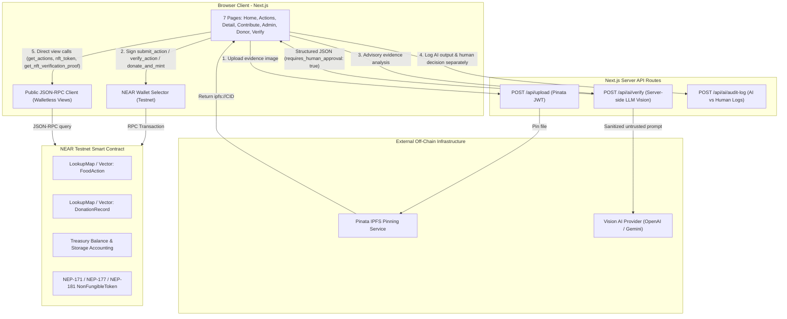

# System architecture — FoodSort

Live contract: `foodsort-app-86051.testnet` ([TESTNET.md](./TESTNET.md)). App sources live in root `src/`.

## 1. Overview

Three tiers with a human-in-the-loop AI assistant:

1. **Client (Next.js App Router)** — seven pages, MyNearWallet (Testnet), public JSON-RPC views for walletless `/verify`.
2. **Server API (`/api/*`)**
   - `POST /api/upload` — Pinata IPFS (server `PINATA_JWT`)
   - `POST /api/ai/verify` — advisory only; no wallet/keys
   - `POST|GET /api/ai/audit-log` — AI vs human decisions logged separately
3. **NEAR Rust contract (`contract/`)** — actions, admin verification, treasury, NEP-171/177/181 Donation NFTs.

---

## 2. Component Responsibilities & Trust Boundaries

### 2.1 Off-Chain Evidence Storage (`/api/upload` -> Pinata IPFS)
- **Why Off-Chain**: Storing raw image binaries on-chain costs ~1 NEAR per 100 KB on NEAR Protocol. Instead, images are pinned to IPFS via Pinata and only the immutable `ipfs://<CID>` URI is written to the smart contract.
- **Validation**: `/api/upload` enforces file presence, allowed image MIME types (`image/jpeg`, `image/png`, `image/webp`), and a 10 MB size ceiling before forwarding to Pinata.
- **No Silent Fakes**: If `PINATA_JWT` is missing or Pinata rejects the upload, `/api/upload` returns an explicit HTTP error (`503` or `502`) so the UI accurately informs the contributor.

### 2.2 Isolated AI Verification Assistant (`/api/ai/verify` & `/api/ai/audit-log`)
- **Strict Isolation**: The AI service operates strictly off-chain as an advisory tool for the human admin.
- **Zero Signing Authority**: The AI service has no NEAR private keys, no wallet session access, and no ability to invoke `verify_action` or `reject_action`.
- **Untrusted Input Handling**: Contributor descriptions and images are treated as untrusted user input. System instructions explicitly guard against prompt injection embedded in descriptions or image text and prohibit the model from claiming food safety certification or proving physical activity occurred solely from a photograph.
- **Manual Fallback**: If the AI service is unconfigured or unreachable, `/admin` displays a clear "AI Service Unavailable — Manual Review Active" state and allows the admin to verify or reject actions manually without interruption.

### 2.3 NEAR Smart Contract State & Treasury Isolation
- **Single Source of Truth for Admin Access**: Even if a non-admin bypassed the `/admin` frontend UI, the smart contract enforces `assert_eq!(env::predecessor_account_id(), self.admin_id, "ERR_NOT_ADMIN")` on `verify_action` and `reject_action`.
- **Server-Independent Attribution**: When a donor calls `donate_and_mint(action_id)`, the contract looks up `let action = self.actions.get(&action_id)` and copies `action.contributor_id` into both the `DonationRecord` and the NEP-177 `TokenMetadata.extra` payload. Frontend callers cannot spoof contributor attribution.
- **Storage vs. Treasury Separation**:
  - Before writing the `DonationRecord` and minting the NEP-171 token, the contract records `storage_before = env::storage_usage()`.
  - After state writes complete, it records `storage_after = env::storage_usage()`.
  - `storage_cost_yocto = (storage_after.saturating_sub(storage_before) as u128) * env::storage_byte_cost().as_yoctonear()`.
  - `net_treasury_amount_yocto = attached_deposit.checked_sub(storage_cost_yocto).expect("ERR_DEPOSIT_BELOW_STORAGE_COST")`.
  - The contract verifies `net_treasury_amount_yocto >= self.min_donation_yocto`, increments `self.treasury_balance_yocto` by `net_treasury_amount_yocto`, and increments `self.total_storage_reserved_yocto` by `storage_cost_yocto`.
- **Held-in-Treasury Invariant**: Every `DonationRecord` and NFT metadata payload explicitly sets `treasury_status: "HELD_IN_TREASURY"`. No payout or distribution claim is ever made.
